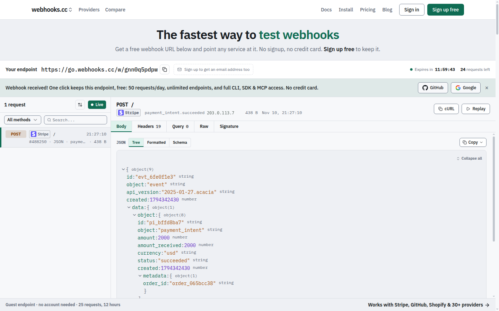

# webhooks.cc

Capture webhooks and email, forward them to localhost, and put the site on your machine at a public link. A hosted service with an open source CLI (`whk`), SDKs for TypeScript, Python and Go, and an MCP server for AI coding agents.

[](https://github.com/kroqdotdev/webhooks-cc/actions/workflows/ci.yml)
[](https://github.com/kroqdotdev/webhooks-cc/releases/latest)
[](https://github.com/kroqdotdev/homebrew-tap)
[](https://github.com/marketplace/actions/setup-whk)
[](#license)
<br>
[](https://www.npmjs.com/package/@webhooks-cc/sdk)
[](https://www.npmjs.com/package/@webhooks-cc/sdk)
[](https://pypi.org/project/webhooks-cc/)
[](https://pypi.org/project/pytest-webhooks-cc/)
[](https://pkg.go.dev/webhooks.cc/go)
<br>
[](https://www.npmjs.com/package/@webhooks-cc/mcp)
[](https://www.npmjs.com/package/@webhooks-cc/mcp)
[](https://registry.modelcontextprotocol.io/v0/servers?search=io.github.kroqdotdev/webhooks-cc)
[](https://glama.ai/mcp/servers/kroqdotdev/webhooks-cc)


No account needed to try it: open [webhooks.cc](https://webhooks.cc) for a capture URL, send it a request, and watch it arrive.

[](https://webhooks.cc)

If webhooks.cc saves you time, a star on this repository helps other developers find it.

## Quick start

Pick where you work.

**In the terminal.** Install `whk`, sign in once, and forward a capture URL to your app, or share the app itself:

```bash
curl -fsSL https://webhooks.cc/install.sh | sh   # or: brew install kroqdotdev/tap/whk
whk auth login
whk tunnel 3000   # a webhook URL whose requests reach localhost:3000
whk share 3000    # https://<name>.sharehooks.cc, served from localhost:3000
```

**In your coding agent.** Add the remote MCP server; you approve the connection once in your browser, with no key to paste:

```bash
claude mcp add -s user --transport http webhooks-cc https://webhooks.cc/mcp
```

**In your tests.** Wait for the webhook or email your code sends, then assert on it:

```bash
npm install @webhooks-cc/sdk      # TypeScript
pip install pytest-webhooks-cc    # pytest fixtures, on the Python SDK
go get webhooks.cc/go             # Go
```

**In the browser.** Visit [webhooks.cc](https://webhooks.cc), copy your URL, and send it a request:

```bash
curl -X POST https://go.webhooks.cc/w/<slug> -d '{"test": true}'
```

## Features

- **Capture requests**: store incoming webhooks with headers, body, query parameters and metadata
- **Capture email**: every endpoint receives mail at `{slug}@mailhooks.cc`, with parsed fields, attachments and authentication results
- **Inspect in real time**: see requests the moment they arrive
- **Configure responses**: return custom status codes, headers and bodies, chosen by rules, to test error paths
- **Verify signatures**: check provider signatures (Stripe, GitHub, Shopify and more) on captured requests
- **Forward**: tunnel webhooks to localhost during development (with `--live`, the sender gets your local app's answer), or forward them to other URLs, chat and file drops
- **Share localhost**: put the site on your machine at a public link on sharehooks.cc with `whk share`
- **CLI for people and agents**: manage endpoints, tunnel, stream and wait for requests from your terminal, with JSON output and stable exit codes for scripts and coding agents
- **SDKs for TypeScript, Python and Go**: wait for and assert on webhooks in tests and CI, and share a local port from code
- **pytest plugin**: `pip install pytest-webhooks-cc` gives every test a capture URL and an email address as fixtures
- **GitHub Action**: [`setup-whk`](https://github.com/marketplace/actions/setup-whk) installs the CLI in a workflow
- **MCP server**: connect AI coding agents (Claude Code, Cursor, VS Code, Codex) to your webhooks

## Use cases

**Testing payment integrations**: point Stripe's test webhooks at your endpoint. Inspect the payload structure before writing handlers.

**Debugging CI/CD hooks**: see exactly what GitHub sends when a push, PR, or deployment occurs.

**Developing locally**: forward production-like webhooks to localhost without exposing your machine to the internet.

**Showing work in progress**: send a teammate or client a link to the app running on your laptop.

**Mocking failure scenarios**: configure your endpoint to return 500 errors and test your retry logic.

## Install

### CLI

```bash
curl -fsSL https://webhooks.cc/install.sh | sh
# or
brew install kroqdotdev/tap/whk
# without root: any directory you can write to (created when missing)
curl -fsSL https://webhooks.cc/install.sh | WHK_INSTALL_DIR="$HOME/.local/bin" sh
```

With `WHK_INSTALL_DIR`, put that directory on your `PATH` (the installer prints the line to add) before running `whk`.

### SDK

```bash
npm install @webhooks-cc/sdk
```

### MCP server

```bash
# Claude Code, remote (sign in once in the browser)
claude mcp add -s user --transport http webhooks-cc https://webhooks.cc/mcp

# Claude Code, local, with an API key
claude mcp add -s user webhooks-cc -e WHK_API_KEY=whcc_... -- npx -y @webhooks-cc/mcp

# Cursor, VS Code, Devin Desktop (formerly Windsurf), Claude Desktop
npx @webhooks-cc/mcp setup cursor --api-key whcc_...
```

See [webhooks.cc/installation](https://webhooks.cc/installation) for all install methods, one-click buttons, and setup guides.

## CLI

```bash
whk tunnel 8080                       # Forward webhooks to localhost:8080
whk share 3000                        # Share localhost:3000 at https://<name>.sharehooks.cc
whk listen <slug>                     # Stream incoming requests, one line each
whk wait <slug> --json                # Block until the next request arrives, print it, exit
whk create my-endpoint                # Create a new endpoint
whk list                              # List your endpoints
whk replay <request-id> --to :3000    # Replay a captured request
whk api endpoints/<slug>/destinations # Call any API route with your credentials
```

Every command takes `--json` (the API's own answers, NDJSON for streams, failures as `{"error": {...}}` on stderr) and exits with a stable status that says what went wrong; see `whk --help`. Nothing waits for input without a terminal: destructive commands need `--yes` there.

## SDK

```typescript
import { WebhooksCC, matchMethod, matchHeader, matchAll } from "@webhooks-cc/sdk";

const client = new WebhooksCC({ apiKey: "whcc_..." });

const endpoint = await client.endpoints.create({ name: "my-webhook" });
console.log(endpoint.url);

// Wait for a matching request with human-readable timeout
const req = await client.requests.waitFor(endpoint.slug, {
  timeout: "30s",
  match: matchAll(matchMethod("POST"), matchHeader("stripe-signature")),
});

// Replay captured requests to your local server
await client.requests.replay(req.id, "http://localhost:3000/webhooks");
```

## MCP server

The `@webhooks-cc/mcp` package exposes 94 tools (91 on the remote server) that let AI agents manage endpoints, inspect webhooks, send test payloads, replay requests, and share a local site at a public link through natural language.

```
You: "Create a webhook endpoint for testing Stripe"
Agent: Created endpoint "stripe-test" at https://go.webhooks.cc/w/abc123

You: "Send a test checkout.session.completed event"
Agent: Sent POST to stripe-test

You: "Replay that to my local server"
Agent: Replayed to http://localhost:3000/webhooks: 200 OK
```

See [`packages/mcp/README.md`](packages/mcp/README.md) for full setup and tool reference.

## Pricing

The free plan has 50 requests a day and 7 days of history, which is enough for development and testing. Pro ($8/month) and Business ($29/month) raise the limits, and teams share endpoints under a per-seat subscription. See [pricing](https://webhooks.cc/pricing) and [plans and limits](https://webhooks.cc/docs/plans-limits).

## Why the code is public

webhooks.cc holds other people's webhooks and email, so the code that handles them should be open to inspection. You can read exactly how a request is captured, stored, forwarded and deleted, and check that the service does what it says. The repository is also where security scanning, dependency updates and bug reports happen in the open.

webhooks.cc is built and run by one developer. The hosted service at [webhooks.cc](https://webhooks.cc) is the product; the repository is not a community project.

## Issues and contributions

- **Bugs and feature requests** are welcome as [issues](https://github.com/kroqdotdev/webhooks-cc/issues/new/choose).
- **Questions about your account, billing or data** go to [webhooks.cc/support](https://webhooks.cc/support), never to a public issue.
- **Security vulnerabilities** are reported privately, see [SECURITY.md](SECURITY.md).
- **Pull requests** are accepted only from people who have signed the [Contributor License Agreement](CLA.md). Open an issue first: most changes are made in-house, and a pull request may be closed or reimplemented. See [CONTRIBUTING.md](CONTRIBUTING.md).

## License

This project uses a split license:

- **AGPL-3.0**: the web app, receiver, email-capture SMTP host, tunnel edge, attachment parser and database schema (`apps/web/`, `apps/receiver-rs/`, `apps/mx-rs/`, `apps/edge-rs/`, `apps/parser-rs/`, `supabase/`). See [LICENSE](LICENSE).
- **MIT**: the CLI and its tunnel protocol crate, the TypeScript, Python and Go SDKs, the pytest plugin, the MCP server, the Zapier and Make apps, and the Claude Code plugin (`apps/cli-rs/`, `crates/tunnel/`, `packages/sdk/`, `packages/sdk-python/`, `packages/pytest-webhooks-cc/`, `packages/sdk-go/`, `packages/mcp/`, `packages/zapier-app/`, `packages/make-app/`, `plugins/`). See the `LICENSE` file in each directory.

The CLI, SDKs and MCP server are MIT so you can use them freely in your own projects, open or closed.
